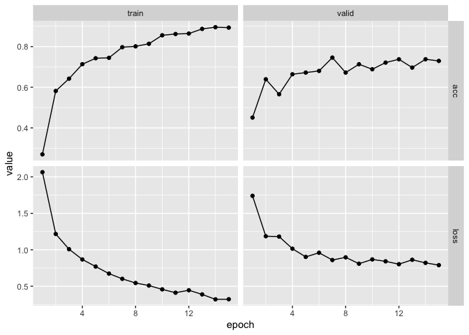
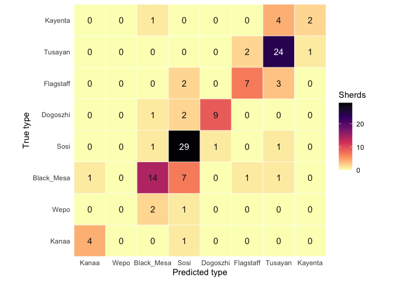

# archy-459-week-5


``` r
library(tidyverse)
library(readxl)
library(rsample)
library(yardstick)
library(torch)
library(torchvision)
library(luz)
library(magick)
source("sherd_helpers.R")
```

Step 1: Import the data The data come from the paper’s supplement on
Zenodo ( (opens in new tab)https://doi.org/10.5281/zenodo.4625156). We
need the spreadsheet of classifications and the folder of 2,407 sherd
images.

``` r
tww_file <- "data/CNN-Models-Supplement/TWW_data.xlsx"
image_dir <- "data/Single_Sherd_8_Type_Analyzer/Reference_Database/Reference_Images"

tww <- read_excel(tww_file)
```

``` r
type_levels <- c("Kanaa", "Wepo", "Black_Mesa", "Sosi", "Dogoszhi", "Flagstaff", "Tusayan", "Kayenta")

sherds <- tww |>
  transmute(
    image = image_file,
    type = factor(`Human consensus`, levels = type_levels),
    paper_prediction = `CNN model prediction`
  ) |>
  mutate(path = file.path(image_dir, image))

count(sherds, type)
```

    # A tibble: 8 × 2
      type           n
      <fct>      <int>
    1 Kanaa        129
    2 Wepo          89
    3 Black_Mesa   509
    4 Sosi         604
    5 Dogoszhi     261
    6 Flagstaff    214
    7 Tusayan      517
    8 Kayenta       84

``` r
sample_prop <- 0.25

set.seed(459)
sherd_sample <- sherds |>
  group_by(type) |>
  slice_sample(prop = sample_prop) |>
  ungroup()

count(sherd_sample, type)
```

    # A tibble: 8 × 2
      type           n
      <fct>      <int>
    1 Kanaa         32
    2 Wepo          22
    3 Black_Mesa   127
    4 Sosi         151
    5 Dogoszhi      65
    6 Flagstaff     53
    7 Tusayan      129
    8 Kayenta       21

``` r
set.seed(459)
sherd_split <- initial_split(sherd_sample, prop = 0.8, strata = type)
train_df <- training(sherd_split)
test_df <- testing(sherd_split)
```

The training set has 478 sherds and the test set has 122 sherds.

``` r
train_dl <- dataloader(sherd_dataset(train_df, 
                                     augment = TRUE), 
                       batch_size = 32, 
                       shuffle = TRUE)

test_dl <- dataloader(sherd_dataset(test_df, 
                                    augment = FALSE),
                      batch_size = 64)
```

``` r
sherd_net <- nn_module(
  initialize = function() {
    self$resnet <- model_resnet18(pretrained = TRUE)
    self$resnet$fc <- nn_linear(512, 8) # fc refers to the Fully Connected layer
  },
  forward = function(x) self$resnet(x)
)
```

``` r
torch_manual_seed(459)

fitted <- sherd_net |>
  setup(
    loss = nn_cross_entropy_loss(),
    optimizer = optim_adam,
    metrics = luz_metric_accuracy()
  ) |>
  set_opt_hparams(lr = 0.0001) |>
  fit(train_dl, epochs = 15, valid_data = test_dl, verbose = FALSE)
```

    Warning: Some torch operators might not yet be implemented for the MPS device. A
    temporary fix is to set the `PYTORCH_ENABLE_MPS_FALLBACK=1` to use the CPU as a
    fall back for those operators:
    ℹ Add `PYTORCH_ENABLE_MPS_FALLBACK=1` to your `.Renviron` file, for example use
      `usethis::edit_r_environ()`.
    ✖ Using `Sys.setenv()` doesn't work because the env var must be set before R
      starts.

    Model weights for <resnet18> (~45 MB) will be downloaded and processed if not
    already available.

``` r
plot(fitted)
```



``` r
test_logits <- predict(fitted, test_dl)
```

    Warning: Some torch operators might not yet be implemented for the MPS device. A
    temporary fix is to set the `PYTORCH_ENABLE_MPS_FALLBACK=1` to use the CPU as a
    fall back for those operators:
    ℹ Add `PYTORCH_ENABLE_MPS_FALLBACK=1` to your `.Renviron` file, for example use
      `usethis::edit_r_environ()`.
    ✖ Using `Sys.setenv()` doesn't work because the env var must be set before R
      starts.

``` r
test_probs <- as_array(nnf_softmax(test_logits, dim = 2)$cpu())

test_results <- test_df |>
  mutate(predicted = factor(type_levels[max.col(test_probs)], levels = type_levels))

accuracy(test_results, truth = type, estimate = predicted)
```

    # A tibble: 1 × 3
      .metric  .estimator .estimate
      <chr>    <chr>          <dbl>
    1 accuracy multiclass     0.730

``` r
conf_matrix <- test_results |>
  count(type, predicted, name = "n") |>
  complete(type, predicted, fill = list(n = 0)) |>
  mutate(dark = n >= max(n) / 2)

ggplot(conf_matrix, aes(predicted, type)) +
  geom_tile(aes(fill = n), colour = "white") +
  geom_text(aes(label = n, colour = dark), size = 4) +
  scale_fill_viridis_c(option = "magma", direction = -1, name = "Sherds") +
  scale_colour_manual(values = c("FALSE" = "grey10", "TRUE" = "white"), guide = "none") +
  coord_fixed(expand = FALSE) +
  labs(x = "Predicted type", y = "True type") +
  theme_minimal()
```

<div id="fig-confusion-matrix">



Figure 1: Confusion matrix of true versus predicted types for the test
sherds

</div>

This figure the true types compared to predicted types, and how many
times the model correctly and incorrectly predicted the pottery type.
The model had the most trouble classifying Wepo, incorrectly classifying
all 3 sherds. It also had trouble with Black Mesa, Flagstadd, Kayenta,
and more. Many of the incorrectly predicted sherds fell into types that
were nearby in time. However some, specifically Black Mesa, had
incorrect predictions all across the time scale. Among the most accurate
are Kanaa with 0.8 recall, Sosi with 0.91 recall, and Tusayan with 0.89
recall. Overall, our accuracy (0.,73) is decently high, although much
lower than the paper’s accuracy (0.89). Our model definitely can predict
many sherds types, but still struggles with classifying many sherds and
specific types.

``` r
comparison <- tibble(
  classifier = c("Our ResNet18", "Paper's CNN ensemble"),
  agreement = c(
    mean(test_results$predicted == test_results$type),
    mean(test_results$paper_prediction == test_results$type)
  )
)

comparison
```

    # A tibble: 2 × 2
      classifier           agreement
      <chr>                    <dbl>
    1 Our ResNet18             0.730
    2 Paper's CNN ensemble     0.885

``` r
recall_by_type <- test_results |>
  summarise(
    n_test = n(),
    recall = mean(predicted == type),
    paper_recall = mean(paper_prediction == type),
    .by = type
  )

precision_by_type <- test_results |>
  summarise(precision = mean(predicted == type), .by = predicted)

recall_by_type |>
  left_join(precision_by_type, by = join_by(type == predicted)) |>
  relocate(precision, .after = n_test) |>
  mutate(across(where(is.double), \(x) round(x, 2)))
```

    # A tibble: 8 × 5
      type       n_test precision recall paper_recall
      <fct>       <int>     <dbl>  <dbl>        <dbl>
    1 Kanaa           5      0.8    0.8          1   
    2 Wepo            3     NA      0            0.33
    3 Black_Mesa     24      0.74   0.58         0.88
    4 Sosi           32      0.69   0.91         0.94
    5 Dogoszhi       12      0.9    0.75         0.92
    6 Flagstaff      12      0.7    0.58         0.83
    7 Tusayan        27      0.73   0.89         0.96
    8 Kayenta         7      0.67   0.29         0.57

Is our model’s accuracy inside the range of the human analysts? Is that
a fair way to judge a CNN?

Our model’s accuracy is about 0.73, while the agreement between human
analysts was between 0.736–0.869, so ours is at the bottom of their
accuracy, slightly below it. This isn’t necessarily a fair way to judge
a CNN since only four expert analysts were used as comparison, and may
get different accuracy every time, while the model should get similar
accuracy every time. This also isn’t a way to judge any other factors,
for example time. An analyst would spend considerable more time looking
at pottery than a model would, but could also pick up things that the
model may have missed, or provide context that a model could not.

Which types are confused most often? Are they neighbours in time? What
does this suggest about the types themselves (for example Wepo)?

The model wrongly predicted 7 Black Mesa sherds as Sosi, 4 Kayenta
sherds were wrongly predicted as Tusayan, and 3 Flagstaff sherds were
wrongly predicted as Tusayan. These are the types with the highest
numbers of wrongly predicted types, and all wrongly predicted types are
neighbors in time with their true types. This suggests that some of
these could be transition types, and do not strictly fit into one
singular type. For example, the study states that Wepo could be a
transition type between Kanaa and Black Mesa, which would explain why it
is wrongly predicted as Black Mesa.
